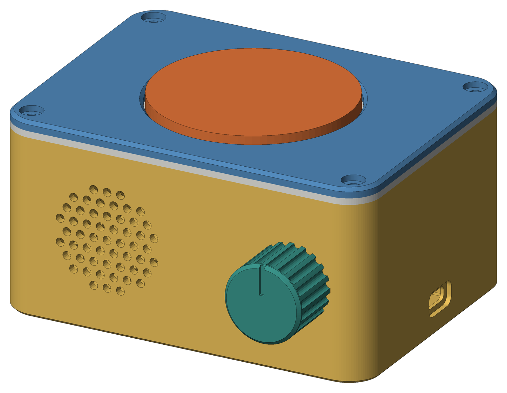

# Figurica radio

Muzička kutija za decu: spustiš figuricu na kutiju i ona pusti svoju pesmu. Kad je skineš, pesma stane, a kad je vratiš, nastavi gde je stala. Nema aplikacije, interneta ni ekrana. Dugme sa strane menja jačinu.

Svaka figurica stoji na odštampanom postolju u kome je zalepljena NFC nalepnica. Radio ne upisuje ništa u nalepnicu, nego čita njen serijski broj. Prva figurica koju spustiš dobija pesmu 1, druga pesmu 2 i tako redom, a radio to pamti i posle gašenja.



## Kako radi

| Deo | Uloga |
|---|---|
| RC522 ispod poklopca | čita serijski broj NFC nalepnice u postolju figurice |
| ESP32-C3 SuperMini | pamti koja figurica pušta koju pesmu i upravlja svim ostalim |
| DFPlayer Mini | pušta MP3 sa microSD kartice na zvučnik od 40 mm |
| Enkoder sa dugmetom | okretanje menja jačinu, klik je pauza, držanje pušta pesmu ispočetka |
| 18650 + TP4056 + step-up | baterija, punjenje preko USB-C i 5 V za module |

Kutija je oko 115 × 86 × 60 mm, a figurica stoji u udubljenju prečnika 60 mm na vrhu.

## Uputstvo korak po korak

Ako nikad nisi lemio ni programirao pločicu, prati korake redom. Svaki korak ima svoju stranu.

1. [Delovi i alat](docs/1-delovi.md): šta da kupiš i na šta da paziš.
2. [Štampa kućišta i postolja](docs/2-stampa.md): STL fajlovi, podešavanja i pauza za NFC nalepnicu.
3. [Lemljenje](docs/3-lemljenje.md): šema, koje žice iz UTP kabla gde idu i kojim redom.
4. [Učitavanje koda na pločicu](docs/4-kod.md): VS Code, PlatformIO, prvi upload i proba modula.
5. [Pesme na SD kartici](docs/5-pesme.md): format kartice i imena fajlova.
6. [Sklapanje](docs/6-sklapanje.md): šta gde ide u kutiji i kojim redom.
7. [Korišćenje](docs/7-koriscenje.md): figurice, dugme, punjenje i brisanje memorije.
8. [Kad nešto ne radi](docs/8-problemi.md): najčešći problemi i kako da ih nađeš.

## Šta je u repozitorijumu

```
firmware/          kod za ESP32-C3 (PlatformIO projekat)
  platformio.ini
  src/
    Config.h       pinovi i sva podešavanja na jednom mestu
    main.cpp       ponašanje radija
    ModuleTest.cpp proba modula pre sklapanja
kuciste/
  stl/             gotovi fajlovi za štampu
  slike/           slike sklopa
  kuciste.py       kućište se generiše iz ove skripte, mere su na vrhu fajla
  postolje.py      postolje figurice
  render.py        slike i provera da se delovi ne sudaraju
docs/              uputstvo
```

## Stanje projekta

Prototip radi: figurice se prepoznaju kroz poklopac, pesme se puštaju i pauziraju, jačina i memorija figurica rade i posle gašenja.

Još nije provereno na uređaju:

- **Merenje baterije.** Na prototipu delitelj napona nije ispravno povezan, pa zaštita od previše ispražnjene baterije u kodu nije isprobana. Zaštita na samom TP4056 radi nezavisno od koda i isključuje bateriju oko 2,4 V.
- **Oporavak posle restarta DFPlayera.** Kad DFPlayer sam restartuje zbog pada napona, radio pušta pesmu figurice ispočetka. Ovo je u kodu, ali još nije isprobano na uređaju.

Mere modula u kućištu su delom izmerene na delovima koje sam imao, a delom uzete iz tipičnih mera. Pre štampe uporedi ih sa svojim modulima ([tabela u koraku 2](docs/2-stampa.md#pre-štampe-uporedi-mere)).

## Licenca

[CC BY-NC-SA 4.0](LICENSE): slobodno pravi, menjaj i deli, uz navođenje autora i pod istom licencom, ali ne za prodaju.
