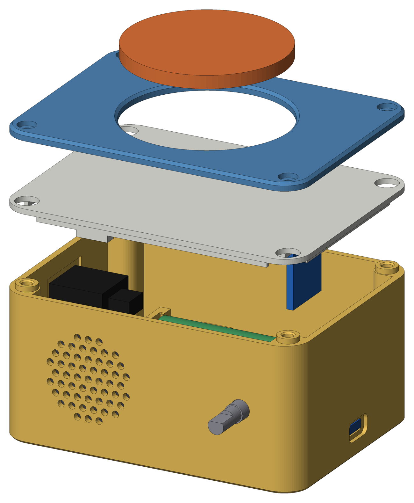
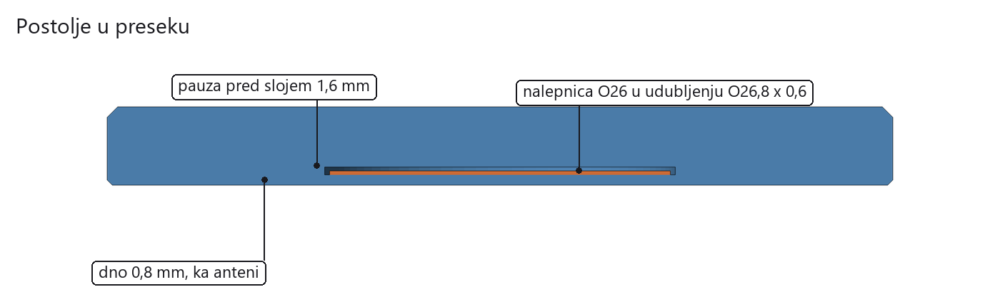

# 2. Štampa kućišta i postolja

[← Delovi](1-delovi.md) · [Sledeći korak: lemljenje →](3-lemljenje.md)

Svi fajlovi su u [`kuciste/stl`](../kuciste/stl). Već su okrenuti onako kako treba da leže na ploči štampača, pa ih samo učitaš u slajser. Nijednom delu ne trebaju potpore.



## Podešavanja

Prototip je štampan u PETG-u. PLA takođe radi, ali omekša na suncu i u kolima.

| Podešavanje | Vrednost |
|---|---|
| Mlaznica | 0,4 mm |
| Visina sloja | 0,2 mm (za postolja **mora** 0,2 mm, vidi ispod) |
| Zidovi | 3 |
| Ispuna | 15–20 % |
| Potpore | ne |

## Delovi

| Fajl | Kom. | Napomena |
|---|---|---|
| `telo.stl` | 1 | Kutija, otvorom nagore. Najduža štampa. |
| `poklopac.stl` | 1 | Već je okrenut naopako: ravna gornja strana leži na ploči. RC522 se kači sa donje strane. |
| `gornja_ploca.stl` | 1 | Ploča sa otvorom za figuricu, ravnom stranom na ploči. |
| `stezaljke_x4.stl` | 1 | Četiri male pločice koje pritiskaju RC522. Trebaju dve, ostale su rezerva. |
| `dugme_D_osovina.stl` | 1 | Dugme za enkoder čija osovina ima ravan deo (oblik slova D). |
| `dugme_nazubljena_osovina.stl` | 1 | Umesto prethodnog, ako je osovina enkodera nazubljena i prorezana. |
| `postolje.stl` | po figurici | Postolje figurice sa skrivenom NFC nalepnicom, sa pauzom (vidi ispod). |

## Postolje figurice i pauza za nalepnicu



Postolje je prečnika 60 mm i visoko 6 mm. Nalepnica leži u udubljenju 0,8 mm iznad dna, da bude što bliže čitaču. Štampač se zaustavi kad završi udubljenje, ti zalepiš nalepnicu, i štampač nastavi preko nje. Nalepnica ostaje zatvorena u plastici i ne vidi se.

1. Učitaj `postolje.stl` i proveri da je visina sloja **0,2 mm**, i za prvi sloj.
2. Ubaci pauzu **pred sloj na visini 1,6 mm**. Slajseri obeležavaju sloj visinom njegovog vrha. Sloj od 1,4 do 1,6 mm je prvi koji pokriva udubljenje, pa pauza mora da bude pre njega.
   - **Bambu Studio / OrcaSlicer:** posle slajsovanja, u pregledu pomeri klizač slojeva na 1,60 mm, desni klik na njega → *Add pause*.
   - **PrusaSlicer:** u pregledu pomeri klizač na 1,60 mm, desni klik na „+“ pored njega → *Add pause print*.
   - **Cura:** *Extensions → Post Processing → Modify G-Code → Add a script → Pause at height*, visina 1,6 mm.
3. Pre štampe pogledaj pregled na sloju 1,4 mm: tu se mora videti otvoreno udubljenje prečnika 26,8 mm.
4. Kad štampač stane, zalepi nalepnicu na sredinu udubljenja i dobro je pritisni prstom, da ivica ne štrči i da je mlaznica ne zakači.
5. Nastavi štampu.

Figuricu posle zalepi na postolje. Lepak i figurica ne smetaju čitanju, ali metal smeta, pa figurica ne treba da ima metalnu osnovu.

Štampaj više postolja odjednom, sa istom pauzom. Pre nastavka zalepi nalepnicu u svako.

## Pre štampe uporedi mere

Kućište nije nacrtano ručno, nego ga generiše skripta [`kuciste/kuciste.py`](../kuciste/kuciste.py). Sve mere su na vrhu fajla. Ako se neki tvoj deo bitno razlikuje, promeni broj i ponovo napravi STL.

| Parametar | Vrednost | Šta je |
|---|---|---|
| `SPK_D`, `SPK_RIM_T`, `SPK_DEPTH` | 40, 2,2, 4,8 | prečnik, debljina oboda i ukupna dubina zvučnika |
| `ENC_D`, `ENC_SHAFT_L` | 7,4, 20 | otvor za navoj enkodera i dužina osovine |
| `SW_W`, `SW_H` | 19,3, 12,4 | otvor za prekidač, meren ispod oboda |
| `TP_L`, `TP_W` | 28, 17,4 | pločica TP4056 |
| `USB_W`, `USB_H`, `USB_ABOVE_PCB` | 9,6, 4,2, 1,6 | USB-C konektor na TP4056 i visina njegovog centra iznad pločice |
| `BAT_D`, `BAT_L` | 18,6, 65,2 | ćelija 18650 |
| `CONTACT_W`, `CONTACT_H` | 13, 11 | pločice kontakata za bateriju |
| `RF_L`, `RF_W` | 60, 40 | pločica RC522 |
| `BAYS` | vidi fajl | ležišta za DFPlayer, ESP32-C3 i step-up: položaj, dužina, širina |
| `INSERT_HOLE`, `INSERT_L` | 4,0, 5,7 | rupa i dužina heat inserta |
| `SCREW_L` | 7 | dužina šrafova, cela kutija je računata na nju |

## Izmena kućišta

Treba ti Python 3.11 ili noviji ([python.org](https://www.python.org/downloads/)). U folderu `kuciste` otvori terminal i pokreni:

```bash
python -m venv .venv
```

```bash
.venv\Scripts\pip install -r requirements.txt
```

Na Linuxu i macOS-u je putanja `.venv/bin/pip`. Posle izmene parametara:

```bash
.venv\Scripts\python kuciste.py
```

```bash
.venv\Scripts\python postolje.py
```

Skripte prepišu fajlove u `stl/`. Skripta `kuciste.py` pre pravljenja STL fajlova proverava da šrafovi ne probijaju dno i poklopac. Ako želiš slike i proveru da li se moduli sudaraju sa kućištem, pokreni `render.py`. Slike završe u `slike/`.

[Sledeći korak: lemljenje →](3-lemljenje.md)
