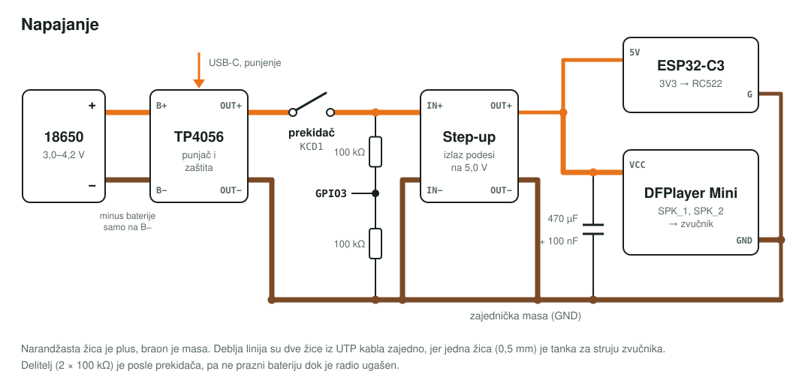
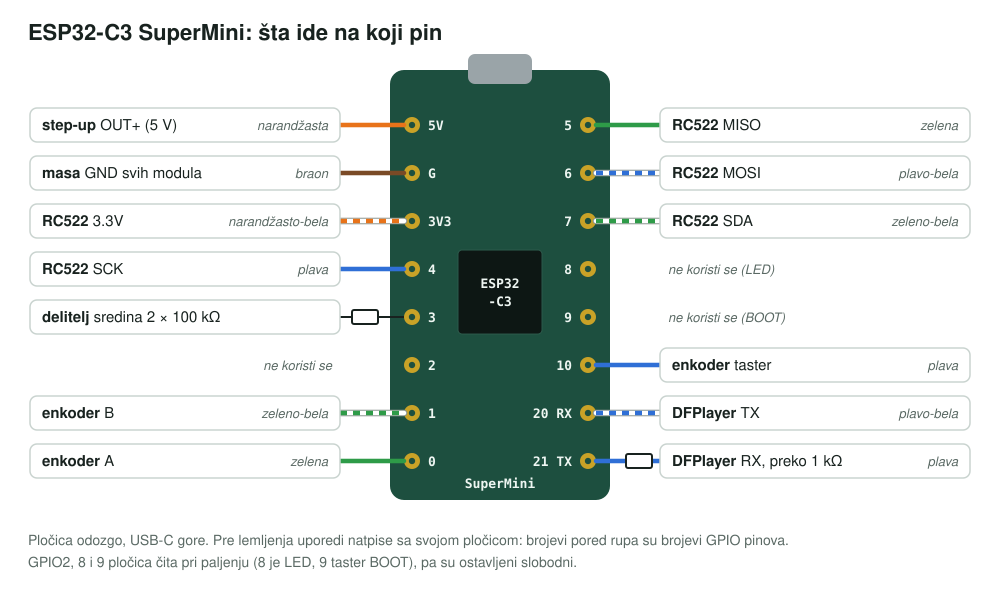

# 3. Lemljenje

[← Štampa](2-stampa.md) · [Sledeći korak: kod →](4-kod.md)

Sve se lemi na stolu, pre sklapanja, sa žicama dovoljno dugim da moduli posle legnu na svoja mesta. Posle lemljenja se kod učita i svaki modul proba ([korak 4](4-kod.md)), pa tek onda sve ide u kutiju.

## Šema

## Žice iz UTP kabla

Za sve žice u kutiji koristi se običan mrežni (UTP) kabl:

- Ima osam žica u četiri boje, pa se svaka veza lako prepozna.
- Žice su od punog bakra, pa drže oblik i lako se kalaišu.
- Metar kabla je dovoljan za ceo radio.

Kupi Cat5e ili Cat6 kabl od **punog bakra**. Na omotaču obično piše „CU“, „solid copper“ ili 24 AWG. Izbegavaj kabl na kome piše **CCA**: to je aluminijum obložen bakrom, teško se lemi i lako puca.

Skini spoljni omotač, razdvoji parice i ispravi žice. Za svaki spoj skini 3–4 mm izolacije, pokalaiši vrh žice i pad na pločici, pa ih spoji.

Jedna UTP žica (0,5 mm) je dovoljna za signale, ali je tanka za struju zvučnika na glasnim delovima pesme. Zato na šemi napajanja **deblja linija znači dve žice zajedno**: upredi ih i lemi kao jednu.

Puna žica puca ako se mnogo puta savija na istom mestu. Žice ka poklopcu (RC522) se savijaju svaki put kad se kutija otvori, pa ih ostavi duže i učvrsti kapljicom vrućeg lepka pored lemnog spoja.

### Koja boja gde

Pravilo je jednostavno: **narandžasta je plus, braon je masa (GND)**. Ostale boje samo razlikuju žice unutar jednog snopa. „Plavo-bela“ je bela žica sa plavom prugom.

| Veza | Boja | Dužina |
|---|---|---|
| plus baterije, TP4056 OUT+ → prekidač → step-up IN+ | narandžasta, 2 žice | 8–10 cm |
| minus baterije, TP4056 OUT− → step-up IN− | braon, 2 žice | 8–10 cm |
| step-up OUT+ → DFPlayer VCC | narandžasta, 2 žice | 10 cm |
| step-up OUT+ → ESP 5V | narandžasta | 10 cm |
| step-up OUT− → zajednička masa | braon, 2 žice | 10 cm |
| ESP 3V3 → RC522 3.3V | narandžasto-bela | 15 cm |
| masa → RC522 GND | braon | 15 cm |
| ESP GPIO4 → RC522 SCK | plava | 15 cm |
| ESP GPIO6 → RC522 MOSI | plavo-bela | 15 cm |
| ESP GPIO5 → RC522 MISO | zelena | 15 cm |
| ESP GPIO7 → RC522 SDA | zeleno-bela | 15 cm |
| ESP GPIO0 → enkoder A | zelena | 10 cm |
| ESP GPIO1 → enkoder B | zeleno-bela | 10 cm |
| ESP GPIO10 → taster enkodera | plava | 10 cm |
| masa → enkoder C i drugi pin tastera | braon | 10 cm |
| ESP GPIO21 → 1 kΩ → DFPlayer RX | plava | 8 cm |
| DFPlayer TX → ESP GPIO20 | plavo-bela | 8 cm |
| DFPlayer SPK_1, SPK_2 → zvučnik | zelena i zeleno-bela | 8 cm |
| step-up IN+ → 100 kΩ delitelja | narandžasta | 10 cm |

Šest žica za RC522 uzmi iz istog komada kabla i ostavi ih upredene u parice: tako se drže zajedno i manje primaju smetnje.

## Redosled

### 1. Napajanje, bez ičega na izlazu

1. Zalemi po dve žice na kontakte za bateriju: narandžaste na ravnu pločicu (plus), braon na oprugu (minus). Lemi pre nego što kontakti uđu u kutiju, jer bi toplota istopila plastiku.
2. Plus baterije na **B+** punjača TP4056, minus na **B−**. Minus baterije ne ide nigde drugde.
3. **OUT+** punjača na jednu nožicu prekidača, druga nožica prekidača na **IN+** step-upa.
4. **OUT−** punjača na **IN−** step-upa.
5. Stavi bateriju u kontakte, pazi na plus i minus, i uključi prekidač.
6. Multimetrom izmeri napon između **OUT+** i **OUT−** step-upa i trimerom ga podesi na **5,0 V**. Ne više: DFPlayer podnosi najviše 5,0 V.
7. Isključi prekidač.

Potrošači uvek idu na OUT+ i OUT− punjača, nikad direktno na bateriju. Samo tako zaštita na TP4056 isključi bateriju kad se isprazni.

### 2. ESP32-C3 i DFPlayer

1. Step-up **OUT+** na pin **5V** ESP-a i na **VCC** DFPlayera. Step-up **OUT−** na **G** ESP-a i **GND** DFPlayera.
2. Elektrolitski kondenzator 470 µF i keramički 100 nF zalemi između VCC i GND DFPlayera, što bliže modulu. Elektrolitski ima polaritet: strana obeležena belom prugom („−“) ide na GND.
3. ESP **GPIO21** preko otpornika **1 kΩ** na **RX** DFPlayera. Otpornik zalemi na samoj nožici RX i preko njega navuci bužir.
4. **TX** DFPlayera na ESP **GPIO20**.
5. Zvučnik na **SPK_1** i **SPK_2**. Zvučnik nikad ne ide na GND.

DFPlayer obično nema natpise pored nožica. Kad ga gledaš odozgo, u koloni u kojoj je SPK_1 nožice idu redom: VCC, RX, TX, DAC_R, DAC_L, SPK_1, GND, SPK_2. Pre lemljenja proveri raspored za svoj modul (pretraži „DFPlayer Mini pinout“).

### 3. RC522

| RC522 | ide na |
|---|---|
| SDA | ESP GPIO7 |
| SCK | ESP GPIO4 |
| MOSI | ESP GPIO6 |
| MISO | ESP GPIO5 |
| IRQ | ništa |
| GND | masa |
| RST | kratka žica na susedni pin 3.3V na samom modulu |
| 3.3V | ESP 3V3 |

Kondenzator 100 nF zalemi između 3.3V i GND na samom modulu. Žice lemi direktno u rupe, bez letvice sa pinovima: tako je modul najtanji i ništa se ne olabavi.

RC522 se napaja **samo sa 3,3 V**. Na 5 V pregori.

### 4. Enkoder

Enkoder ima tri nožice sa jedne strane i dve sa druge.

| Enkoder | ide na |
|---|---|
| A (krajnja od tri) | ESP GPIO0 |
| C (srednja od tri) | masa |
| B (druga krajnja od tri) | ESP GPIO1 |
| taster, prva nožica | ESP GPIO10 |
| taster, druga nožica | masa |

Srednju nožicu i jednu nožicu tastera spoji kratkom žicom na samom enkoderu, pa do mase ide jedna žica. Otpornici za enkoder nisu potrebni, ESP ima svoje.

Ako jačina posle raste na pogrešnu stranu, ne prelemljuj: to se menja u kodu ([korak 4](4-kod.md#podešavanja)).

### 5. Delitelj za merenje baterije

Dva otpornika od 100 kΩ zalemi direktno na ESP:

1. Prvi otpornik između **GPIO3** i **G**.
2. Drugi otpornik jednom nožicom na **GPIO3**, a drugom na narandžastu žicu koja ide na **IN+** step-upa, posle prekidača.

Tako GPIO3 dobija pola napona baterije, najviše 2,1 V. Delitelj je posle prekidača, pa ne prazni bateriju dok je radio ugašen.

## Pazi na ovo

- **Baterija se nikad ne lemi direktno.** Lemi samo kontakte, pre nego što baterija uđe.
- **Ne kratko spajaj plus i minus baterije**, ni na trenutak. 18650 daje dovoljno struje da istopi žicu.
- Dok je ESP povezan na računar, prekidač radija drži **isključen**. Tada radio radi sa USB-a, bez baterije.
- Posle svakog koraka pogledaj spojeve sa lupom ili telefonom: da nema kapi kalaja između susednih nožica.

[Sledeći korak: učitavanje koda →](4-kod.md)
