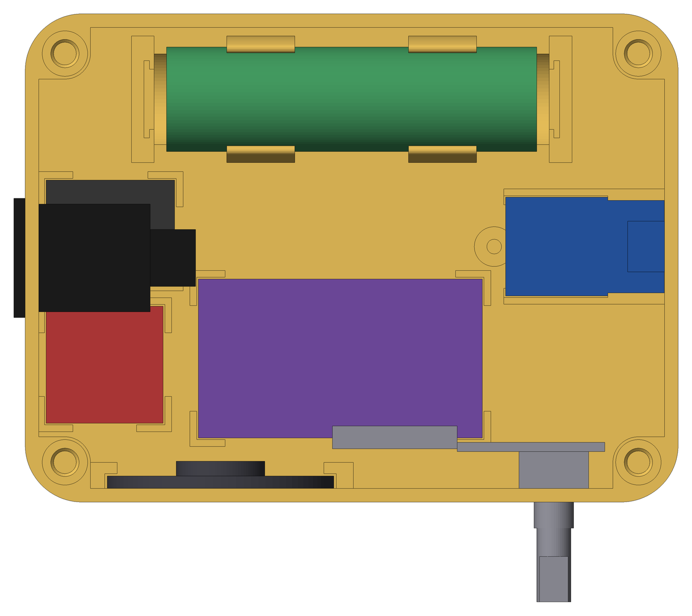
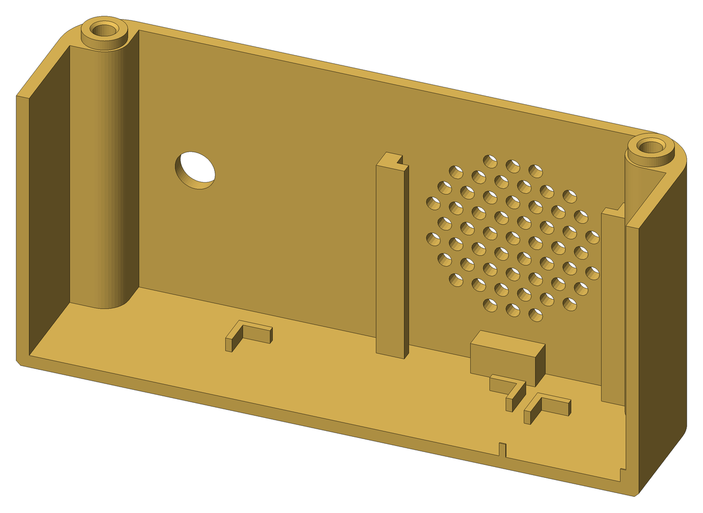
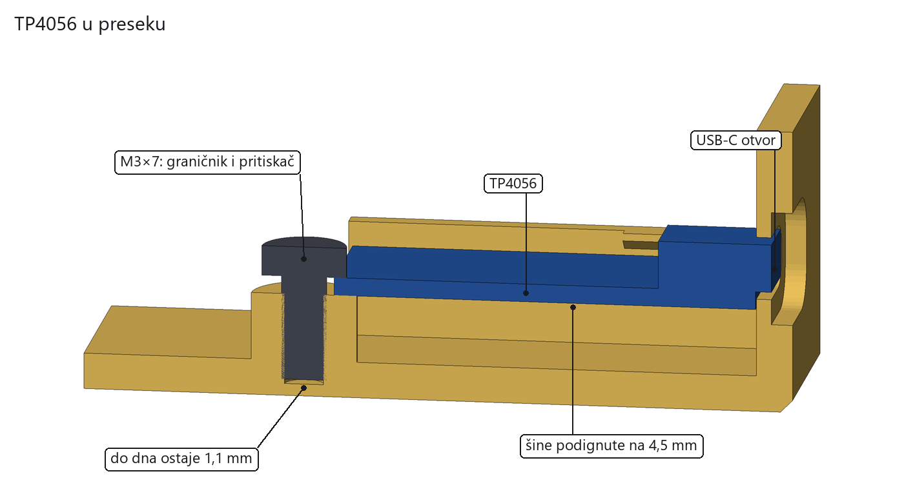
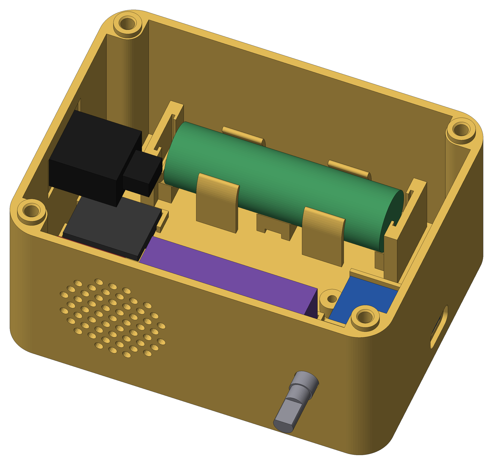
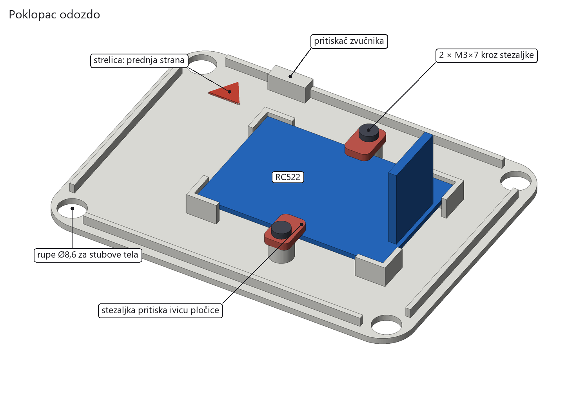
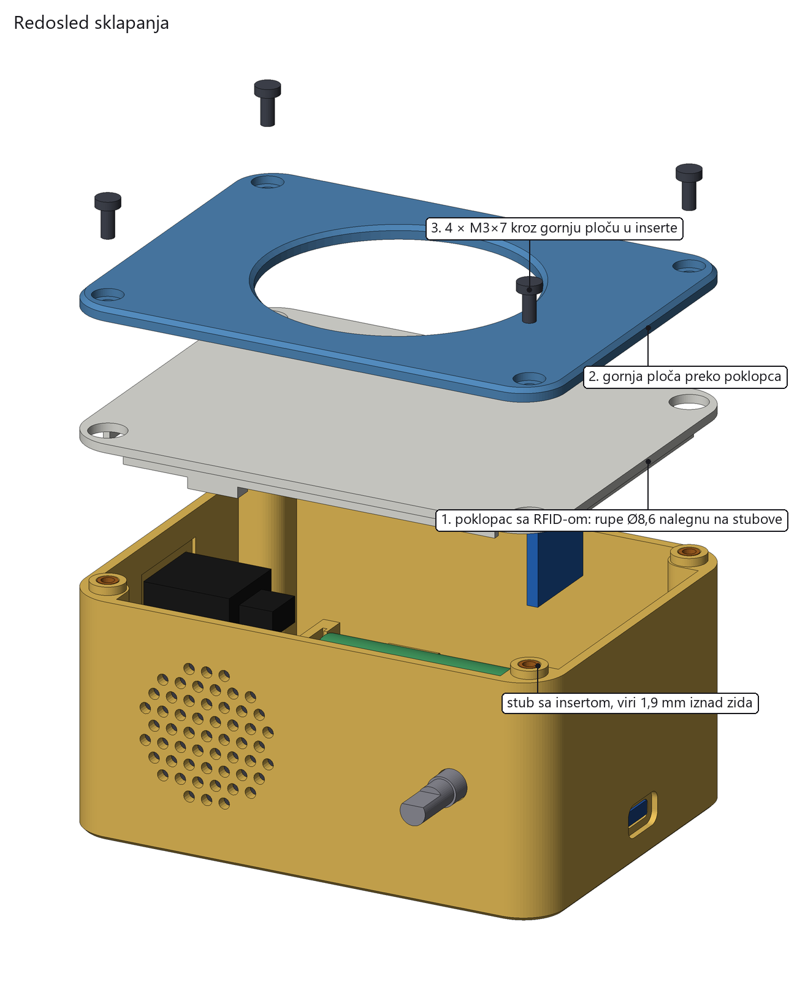

# 6. Sklapanje

[← Pesme](5-pesme.md) · [Sledeći korak: korišćenje →](7-koriscenje.md)

Prednja strana kutije je ona sa rešetkom za zvučnik i enkoderom. Prekidač je na levom zidu, a USB-C za punjenje na desnom.

Na slici je prednja strana dole. Zelena je baterija, ljubičasti step-up, plavi TP4056, crveni DFPlayer, tamnosivi ESP32-C3, a crni prekidač.

## 1. Heat inserti

Četiri inserta idu u vrhove stubova u uglovima kutije. Zagrej lemilicu na oko 220 °C, stavi insert na rupu i lagano ga utiskuj vrhom lemilice, pravo nadole, dok ne bude u ravni sa vrhom stuba. Ne guraj na silu, pusti da plastika omekša.

## 2. Prekidač

Žice prekidača provuci kroz otvor na levom zidu spolja, pa utisni prekidač dok zupci ne škljocnu.

## 3. Enkoder

Enkoder uvuci iznutra kroz otvor na prednjem zidu i spolja zavrni navrtku. Ako enkoder pored navoja ima mali zubac, odlomi ga kleštima, da enkoder legne ravno uz zid.

## 4. Zvučnik

Zvučnik se spušta odozgo u žleb iza rešetke, membranom ka rešetki. Odozgo ga posle pritisne ispust na poklopcu, pa ga ne treba lepiti.

## 5. TP4056

Uvuci pločicu u šine na desnom zidu, tako da USB-C konektor uđe u otvor. Iza pločice zavrni šraf M3×7 u rupu u dnu: glava šrafa sprečava da pločica klizne nazad kad utakneš kabl.

## 6. Baterija

1. Kontakte, sa već zalemljenim žicama, gurni odozgo u žlebove na krajevima ležišta: ravnu pločicu na jednu stranu, oprugu na drugu.
2. Utisni bateriju između njih, plus ka ravnoj pločici, dok je kopče ne obuhvate.
3. Ako hoćeš, provuci usku vezicu kroz tunel ispod srednjeg oslonca i stegni je preko baterije.

## 7. Moduli na dnu

Dno ima male ugaone graničnike za svaki modul. Zalepi module dvostranom trakom ili kapljicom vrućeg lepka:

- **DFPlayer** u prednji levi ugao, iza zvučnika. Prethodno ubaci SD karticu i okreni modul tako da slot za karticu ostane slobodan, da karticu možeš da izvadiš kad skineš poklopac.
- **ESP32-C3** levo, iza DFPlayera. Okreni ga tako da USB-C konektor bude dostupan odozgo, jer se kod za izmene učitava sa skinutim poklopcem.
- **Step-up** u sredinu, ispred baterije.

## 8. RC522 na poklopac

1. Okreni poklopac naopako. Strelica na donjoj strani pokazuje ka prednjoj strani kutije.
2. Stavi RC522 između četiri ugaona graničnika: strana sa čipom ka poklopcu, žice nadole, u kutiju.
3. **Kraj RC522 sa pinovima mora biti na strani USB-C otvora** kad poklopac stoji na kutiji. Antena je pomerena ka drugom kraju pločice, i samo u tom položaju je tačno ispod figurice. Ako je pločica okrenuta obrnuto, antena je 2 cm sa strane i figurica se slabo čita.
4. Preko ivica pločice stavi dve stezaljke i zavrni ih šrafovima M3×7 u stubiće. Šraf sam pravi navoj u plastici, pa ga ne pritežeš previše.

## 9. Proba pre zatvaranja

Uključi prekidač, stavi poklopac labavo na kutiju i spusti figuricu u udubljenje. Ako pesma krene, sve je povezano kako treba. Ako ne, pogledaj [korak 8](8-problemi.md) pre zatvaranja.

## 10. Zatvaranje

1. Složi žice tako da ne prelaze preko RC522 i da ih stubovi ne prikleste.
2. Spusti poklopac: stubovi iz uglova kutije prolaze kroz rupe na poklopcu, a strelica gleda napred.
3. Preko poklopca stavi gornju ploču.
4. Zavrni četiri šrafa M3×7 kroz gornju ploču u inserte. Gornja ploča stegne poklopac uz kutiju.
5. Natakni dugme na osovinu enkodera. Urez na dugmetu je oznaka položaja.

[Sledeći korak: korišćenje →](7-koriscenje.md)
